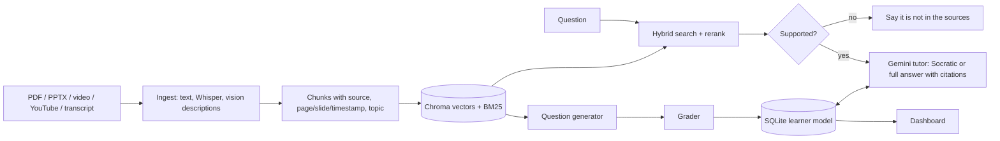

# StudyMate: source-cited AI study companion
Multimodal AI Hackathon 2026, Track D (Personalized Tutoring & Adaptive Learning).

Upload lecture videos (or YouTube links), textbooks and slides. StudyMate builds one knowledge base, answers questions with clickable citations (lecture timestamp, page, slide), tutors Socratically, runs adaptive quizzes, and tracks mastery per topic.

## Folder layout (after extracting studymate_full.zip)
```
studymate/
  backend/      FastAPI app (ingest, retrieval, tutor, quiz, learner model)
  frontend/     Next.js + Tailwind UI
  sample_data/  demo course + load_sample.py
  eval/         eval.py (citation accuracy, question quality)
  docs/         README, Devpost text, demo script
```

## Run it
Requirements: Python 3.10+, Node 18+, ffmpeg (for video/audio), a free Gemini API key (aistudio.google.com).

Backend
```
cd backend
cp .env.example .env        # add GEMINI_API_KEY
pip install -r requirements.txt && uvicorn main:app --reload --port 8000
```
Load the demo course (new terminal, backend deps installed)
```
cd sample_data && python load_sample.py
```
Frontend
```
cd frontend
cp .env.example .env.local
npm install && npm run dev      # http://localhost:3000
```
Evaluation
```
cd eval && python eval.py       # writes results.json
```
The first run downloads the Chroma embedding model (about 80 MB) and, for videos, the Whisper model.

## Architecture


## How the requirements are met
- **Ingestion:** PDF text by page; PPTX text, notes and slide pictures; video/audio/YouTube via faster-whisper with timestamps; transcripts as `[mm:ss] text`. Images in PDFs and slides are described by a vision model. Chunks get an LLM topic tag.
- **Retrieval:** Chroma semantic search plus BM25, fused with reciprocal rank fusion and a semantic-similarity rerank boost.
- **Citations:** the model cites sources as `[S1]`; the UI turns each into a chip (for example `lecture, 3:40`) that opens the source viewer at the timestamp, page or slide. Answers below a confidence threshold are refused instead of guessed.
- **Tutor:** if mastery of the topic is under 0.6, it gives a hint and a guiding question first; "Show full answer" reveals the rest.
- **Adaptive quizzes:** MCQ, short-answer and application questions grounded in a source passage. Difficulty targets mastery + 0.1. Mastery updates with an Elo-style rule; the review interval doubles after a correct answer and resets after a miss. Due and weak topics are picked first.
- **Dashboard:** mastery heatmap, progress line, weak topics, next-session plan with source links.

## Assumptions
- LLM is Gemini through the Google AI Studio API (free tier) (set `LLM_MODEL` to change). Judging criteria from the Track D document were not available when this was built; check them and adjust.
- Single learner, no login. Data lives in `backend/data/`.
- Reranking is rank fusion plus a similarity boost, not a cross-encoder.
- PPTX and PDF viewing: PDFs open at the cited page; slides show the cited slide's text.
- Sample lecture is a timestamped transcript so the demo needs no video file or Whisper download.
